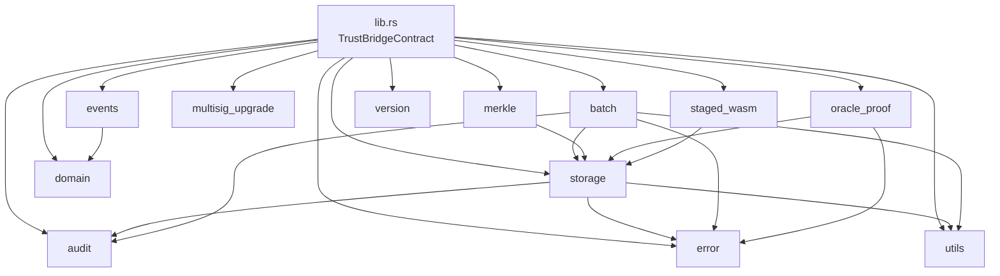
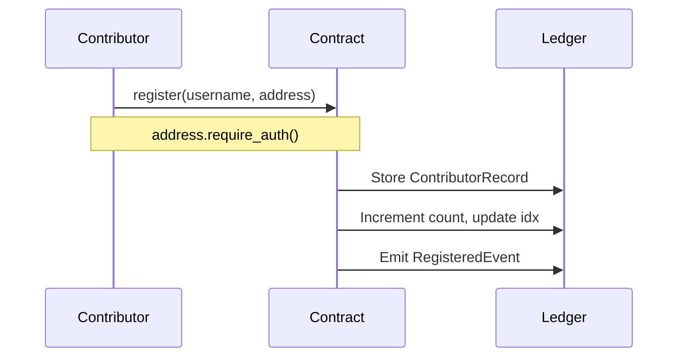
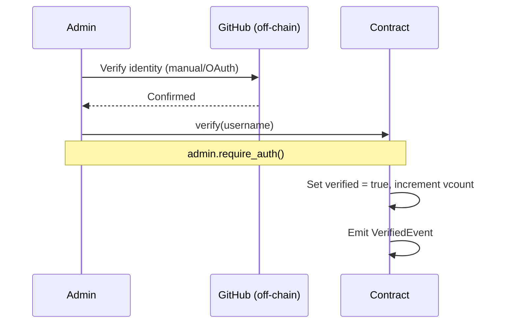
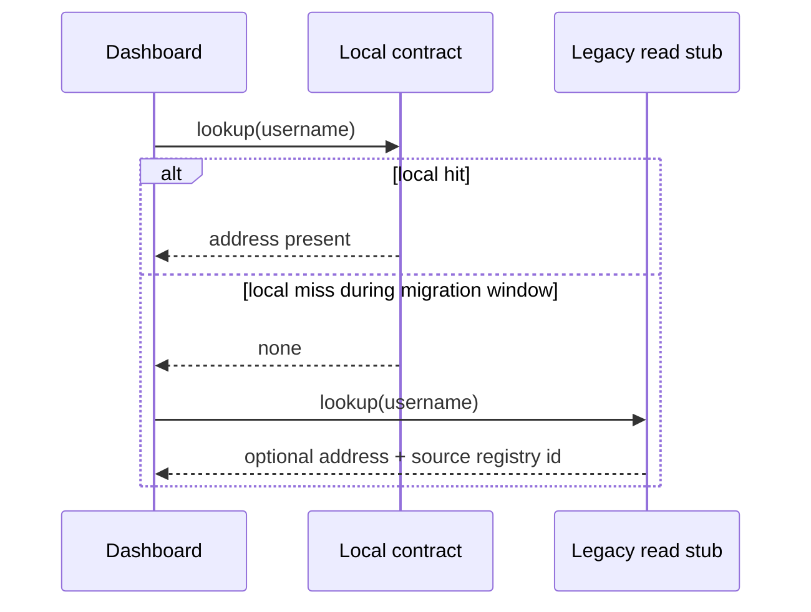

# Architecture

This document describes the design of **trustbridge-contract** — the on-chain GitHub username registry for TrustBridge on Stellar Soroban.

Related docs: [README](../README.md) · [ABI](ABI.md) · [DEPLOYMENT](DEPLOYMENT.md) · [CONTRIBUTING](CONTRIBUTING.md) · [CONTRACT_HEALTH](CONTRACT_HEALTH.md)

---

## System Context

TrustBridge connects open-source contribution on GitHub to Stellar-based rewards. This contract is the **identity bridge**:

```
GitHub username  ──register──►  Soroban contract  ◄──lookup──  GitHub Action / Dashboard
                                      │
                                      ▼
                               Stellar G-address
```

Consumers:

1. **Contributors** — register their GitHub → Stellar mapping
2. **GitHub Action** — resolves usernames to payout addresses at CI time
3. **Dashboard** — displays registry state, verification status, and stats
4. **Admin** — verifies identities off-chain and marks them on-chain

Operational monitors should use `get_health` (Issue #210) for a single packed
snapshot: pause state, schema version, registration counts, upgrade cooldown, and
attestation presence. See [CONTRACT_HEALTH.md](CONTRACT_HEALTH.md) for the full
reference and migration guide from manual probing.

---

## Contract Modules

Every `src/*.rs` file on disk is listed here — no more, no fewer
(`audit.rs`, `batch.rs`, `domain.rs`, `error.rs`, `events.rs`, `lib.rs`,
`merkle.rs`, `multisig_upgrade.rs`, `oracle_proof.rs`, `staged_wasm.rs`,
`storage.rs`, `utils.rs`, `version.rs`), plus the `src/contract/` entrypoint
modules and the `src/test.rs` unit-test module listed in the
[module map](#module-map). `src/lib.rs` owns module wiring, re-exports and
the `TrustBridgeContract` type; its entrypoints live in `src/contract/`.

| Module | Responsibility |
|--------|----------------|
| `src/lib.rs` | Module wiring, `pub use` re-exports, `#[contract] TrustBridgeContract`, shared private helpers (`event_domain`, `mark_verified`, …) |
| `src/contract/*.rs` | `#[contractimpl]` entrypoints, one block per concern — see [module map](#module-map) |
| `src/test.rs` | Unit tests for the contract entrypoints (`#[cfg(test)]` only) |
| `src/storage.rs` | Storage keys, `ContributorRecord` / `Stats` types, persistence helpers, flat/chunked index maintenance, opaque cursor pagination internals (Issue #215) |
| `src/events.rs` | Soroban contract events with topics (`#[contractevent]` structs) |
| `src/error.rs` | Typed error enum (`ContractError`) and off-chain retry classification (`ErrorCategory`) |
| `src/audit.rs` | Append-only audit-log entry type (`AuditLogEntry`, `AuditConfig`, `AuditStats`) and helpers |
| `src/batch.rs` | Batch verification implementation, configuration, limits, and tests |
| `src/merkle.rs` | Export-page Merkle leaf/node hashing and root construction (Issue #216) |
| `src/multisig_upgrade.rs` | M-of-N multisig upgrade proposal flow (Issue #301) |
| `src/oracle_proof.rs` | Oracle allowlist and signed proof-of-ownership verification |
| `src/staged_wasm.rs` | Staged-WASM intent slot gating `upgrade` (Issue #300) |
| `src/domain.rs` | `EventDomain` (contract id, network id, version) attached to every event |
| `src/utils.rs` | Username validation (incl. case folding) and other pure helpers |
| `src/version.rs` | Contract version type, compatibility checks, cross-contract read gating |

> There is no separate registry-read module. During a migration window the
> on-chain registry is the single source of truth and off-chain consumers read
> it directly through the public read surface (see `docs/ABI.md` §
> Cross-Contract Read Interface); a `registry_read_stub.rs` trait fixture was
> staged for this and removed as unused (Issue #297).

### Module map

`TrustBridgeContract` entrypoints are split across `src/contract/` (Issue #601).
Each file holds one `#[contractimpl]` block on the same type; Soroban merges
them, so the exported entrypoints and contract spec are unchanged by the split.
Every file starts with `use crate::*;` so it sees the same imports and private
helpers that lived beside the single block in `lib.rs`. Helper methods shared
between files are `pub(crate)` — `#[contractimpl]` only exports `pub fn`, so
they stay off the ABI.

| File | Entrypoints |
|------|-------------|
| `contract/admin.rs` | `initialize`, `pause` / `unpause`, guardian, emergency pause |
| `contract/roles.rs` | Role grants (timelocked / expiring), network tag, verifier allowlist |
| `contract/governance.rs` | Cooldown / verify limits, versioning, upgrade attestation & provenance, `upgrade`, staged WASM, multisig upgrade |
| `contract/config.rs` | Verification config / expiry, audit logs and audit config |
| `contract/registry.rs` | `migrate`, username helpers, `register` / `register_sponsored`, TTL, `remove` / `batch_remove` (dual control), lookups, exports, `set_paused` |
| `contract/verify.rs` | `verify`, oracle allowlist & proofs, `batch_verify`, `revoke_verification`, bot status, verified count |
| `contract/rotation.rs` | `rename`, delayed address rotation |
| `contract/health.rs` | Pause reason, stats, last event ledger, `get_health` |
| `contract/challenge.rs` | Challenge-period flow |
| `contract/maintenance.rs` | Status helpers, reserved usernames, `compact_index`, `repair_index` |

New entrypoints go in the file matching their concern; add a file (and list it
here, in `contract/mod.rs`, and in `CONTRACT_SRCS` in `tests/auth_matrix.rs`)
only for a genuinely new concern.

### `lib.rs` re-export strategy

Submodules stay private (`mod audit; mod batch; …` in `lib.rs`) and the
cross-crate surface is re-exported with `pub use`: contract types
(`AuditConfig`, `AuditLogEntry`, `Role`, `Stats`, `PendingRoleGrant`,
`ExportPage`, …), all events, `ContractError`, and the `OracleProof` /
`StagedWasm` / `Version` helpers. External consumers (integration tests, SDK
bindings) import everything from the crate root
(`trustbridge_contract::{TrustBridgeContract, Role, …}`) and never address a
submodule path — so a future module split only touches `lib.rs` imports, not
downstream callers.

### Module dependencies



`storage.rs` is the hub: index/counter/cursor/audit persistence plus the key
constants everything else names. `events.rs` only depends on `domain.rs`
(the `EventDomain` stamped on each event). Nothing depends on `lib.rs`.

### Test locations by domain

| Domain | Tests |
|--------|-------|
| Cursor pagination (Issues #215, #650) | `tests/cursor_pagination.rs`, `fuzz/fuzz_targets/export_cursor.rs`, `tests/fuzz/seeds.txt` |
| Pagination parity across the three export APIs (Issue #302) | `tests/pagination_parity.rs` |
| Export page layout golden | `tests/export_page_layout.rs`, `abi/export_page.layout.golden` |
| Timelocked role grants (Issues #220, #648) | `tests/integration.rs`, `tests/auth_matrix.csv` |
| Audit reads (Issue #646) | `tests/integration.rs`, `src/test.rs` unit tests |
| Domain binding (Issue #659) | `tests/domain_binding.rs`, `tests/network_mismatch.rs`, `tests/username_case_fold.rs` |
| NormalizeRegisteredAt migration (Issue #605) | `src/storage.rs` (`normalize_registered_at_migration_tests`) |
| Dual-control batch_remove (Issue #219) | `tests/batch_remove_dual_control.rs` |
| Challenge flow (Issue #214) | `tests/challenge.rs` |
| Merkle proofs (Issue #216) | `tests/merkle_export.rs` |
| Error-code stability (Issue #402) | `tests/contract_error_codes.rs`, `abi/contract_error_codes.golden` |
| Bindings golden | `tests/bindings_golden.rs` |
| Counter model proofs (Issue #241) | `tests/counter_proofs.rs` |
| Property fuzz suite | `src/test.rs` unit tests, `tests/fuzz/seeds.txt` — see `docs/REGISTRY_INVARIANTS.md` |

Related docs: [ABI](ABI.md) (entry-point reference, pagination selection
guide, audit reads) · [REGISTRY_INVARIANTS](REGISTRY_INVARIANTS.md)
(counter/export invariants I1–I10, fuzzing) ·
[ADMIN_RUNBOOK](ADMIN_RUNBOOK.md) (operator flows).

### Notes

- The contract crate is `#![no_std]` (`src/lib.rs`): `no_std`-incompatible
  crates (e.g. `proptest`) cannot be used in-contract, so the property suite
  uses a small xorshift generator instead (see
  `docs/REGISTRY_INVARIANTS.md`). Integration tests under `tests/` link std
  normally.
- When splitting a module (e.g. a future pagination module), update this
  table, the sketch above, the [module map](#module-map), and the `pub use`
  list in `lib.rs` in the same PR.

---

## Storage Layout

### Instance Storage (single contract instance)

| Key | Type | Description |
|-----|------|-------------|
| `Symbol("admin")` | `Address` | Contract administrator |
| `Symbol("count")` | `u32` | Total active registrations |
| `Symbol("vcount")` | `u32` | Count of verified registrations |
| `Symbol("idx")` | `Vec<String>` | Ordered list of registered usernames (for admin export) |
| `Symbol("ver")` | `(u32, u32, u32)` | Contract schema version tuple |

### Persistent Storage (per-entry, TTL-extended)

| Key | Type | Description |
|-----|------|-------------|
| `(Symbol("reg"), github_username)` | `ContributorRecord` | Per-user registration record |

### ContributorRecord

```rust
pub struct ContributorRecord {
    pub stellar_address: Address, // identity address that owns the registration
    pub payout_address: Address,  // where payouts go; defaults to stellar_address
    pub registered_at: u32,       // ledger timestamp (u32 saves 4 bytes/record)
    pub verified: bool,           // set by admin or Verifier after an off-chain check
    pub is_bot: bool,
}
```

> **Org and Team registrations do not exist** (Issue #398). This section
> previously documented an `entity_type` / `org_name` pair on the record, an
> `EntityType` enum, and `orgidx` / `tmidx` indexes. None of it was reachable:
> the record carried no such fields, no entry point wrote either index, and the
> index helpers only called each other. The types and keys have been removed
> rather than completed — documenting a registry surface the contract does not
> have is worse than not having it, because an integrator reads the docs and
> builds against an ABI that will never answer.
>
> If organisation-scoped registration is wanted later, it should be designed
> against the current record shape rather than resurrected from the removed
> stubs, which never had a write path to review.

### Design Notes

- **`idx` index:** Soroban does not support iterating arbitrary storage keys. The username index enables `get_all_registered()` without scanning the entire ledger. It is the *only* index — see the note above on the removed org/team indexes.
- **`vcount` counter:** Maintained incrementally so `get_stats()` is O(1) rather than scanning all records.
- **Single-record reads are O(1) (Issue #291):** `has_record`, `get_address`,
  and `get_record_proof` resolve through a direct persistent-key lookup on
  `(REG_KEY, github_username)`. They never walk the flat `idx` index or the
  chunked index, so their cost is independent of the number of registrations
  and the number of chunks — a registry with 10k users across 200 chunks reads
  a single username in exactly the same number of storage operations as an
  empty one. The chunked index is only consulted by the explicitly paginated
  export paths (`get_public_paginated`, `get_registered_page`), never by point
  lookups. `has_record` additionally skips deserialization and the TTL bump
  that `get_record` performs.
- **Re-registration:** Updating an existing username overwrites the record. If the Stellar address changes, `verified` resets to `false` unless the address is unchanged.
- **Rent / Wave budgeting:** Dashboard UIs that estimate storage rent from N
  users should consume the versioned estimator inputs in
  [STORAGE_RENT_ESTIMATOR.md](STORAGE_RENT_ESTIMATOR.md) (on-chain rent only;
  indexer disk is separate).

---

## Authorization Model

Soroban uses explicit address authorization via `Address::require_auth()`.

| Function | Who must authorize |
|----------|-------------------|
| `initialize` | No auth (one-time setup; protect deploy pipeline) |
| `register` | The `stellar_address` being registered |
| `remove` | The `caller` argument — must equal admin or registrant |
| `get_all_registered` | Admin |
| `verify` | Admin **or** `Role::Verifier` |
| `revoke_verification` | Admin **or** `Role::Revoker` (Issue #212) |
| `start_challenge` / `cancel_challenge` / `complete_challenge` | Admin |
| `get_address`, `get_stats`, `get_health` | None (read-only) |

### Role matrix (Issue #212 — Verifier / Revoker split)

| Role | verify | revoke_verification | upgrade | set_role |
|------|--------|---------------------|---------|----------|
| Admin | ✅ | ✅ | ✅ | ✅ |
| Verifier | ✅ | ❌ | ❌ | ❌ |
| Revoker | ❌ | ✅ | ❌ | ❌ |
| Upgrader | ❌ | ❌ | ✅ | ❌ |

Separating Verifier from Revoker prevents a compromised Verifier key from
silently revoking payout eligibility for existing contributors.

**Migration for live Verifier holders:** Existing `Role::Verifier` addresses
keep their verify permission. If they previously relied on revoke, re-assign
them `Role::Revoker` via `set_role`.

### Why `remove` takes a `caller` argument

Soroban contracts cannot inspect the transaction source account without an explicit argument. When multiple parties (registrant **or** admin) may call the same function, the contract requires `caller: Address` so it can:

1. Call `caller.require_auth()` to validate the signature
2. Check `caller == admin || caller == record.stellar_address`

See [Stellar auth documentation](https://developers.stellar.org/docs/build/smart-contracts/example-contracts/auth) for background.

---

## Public reads vs. pause: conformance matrix (Issue #294)

The pause circuit breaker (`pause` / `set_paused` / `emergency_pause`) stops
**state mutations only**. Every public (no-auth) read must keep working while
the contract is paused, so that an indexer, the GitHub Action, and the
dashboard can keep resolving identities and syncing state through a maintenance
or security freeze. Issue #3 established this for `get_public_paginated`; a
later change had accidentally regressed it behind `require_not_paused` — that
gate has been removed and the whole surface is now locked down by a test.

`test_conformance_public_reads_available_while_paused` in
`tests/integration.rs` pauses the contract and asserts every row below returns
`Ok` (or a non-`Paused` domain result such as `None`). Adding a public read
without adding it to that test — or slipping a `require_not_paused` into one of
these paths — fails CI.

### Public reads — MUST succeed while `paused == true`

| Read | Returns | Notes |
|------|---------|-------|
| `get_address(username)` | `Option<ContributorRecord>` | core identity lookup |
| `has_record(username)` | `bool` | existence check |
| `get_record_proof(username)` | `RecordProof` | light-client proof |
| `get_public_paginated(cursor, limit)` | `Result<ExportPage, _>` | **regression fixed here** — was `Paused`, now only `NotInitialized` can fail it |
| `get_stats()` | `Stats` | totals |
| `get_verified_count()` / `get_ever_verified_count()` | `u32` | counters |
| `get_health()` | `HealthSnapshot` | packed status probe |
| `version()` / `get_version()` / `is_compatible(...)` | version data | schema reads |
| `is_paused()` / `is_contract_paused()` / `is_emergency_paused()` | `bool` | pause status itself |
| `emergency_pause_timestamp()` | `u64` | |
| `get_pause_reason()` | `PauseReason` | why it was paused |
| `get_role(addr)` / `get_role_holders(...)` / `get_role_holder_count()` | RBAC reads | |
| `get_cooldown()` / `get_rotation_delay()` / `get_pending_rotation(username)` | config reads | |
| `get_guardian()` / `get_attestation()` / `get_provenance()` | governance reads | |
| `get_verification_config()` / `get_challenge(username)` / `get_reserved_list()` / `is_reserved(username)` | config reads | |
| `get_network_tag()` | `Option<BytesN<32>>` | |
| `max_username_len()` / `is_username_valid(u)` / `is_address_zero(a)` / `usernames_match(a, b)` | pure helpers | |
| `get_audit_logs()` / `get_audit_stats()` | audit reads | |

### Admin-only reads — allowed while paused **but still require admin auth**

These are not gated by pause, but they are gated by `admin.require_auth()`, so
a non-admin caller gets `NotAuthorized` (pause or not). They are listed
separately and are **not** part of the "no-auth read" conformance set.

| Read | Auth |
|------|------|
| `get_all_registered()` | admin |
| `get_registered_page(offset, limit)` | admin |
| `get_registered_paginated(cursor, limit)` | admin |

### Policy

Changing which functions the pause flag blocks is **out of scope** for routine
PRs. If a genuine bug is found (a public read wrongly gated, or a mutation
wrongly allowed), fix it *and* update this table and the matrix test in the
same PR.

---

## Challenge-Period Flow (Issue #214)

Admin force-remove is normally instant. The challenge flow introduces a mandatory
delay so the registrant has time to prove GitHub ownership off-chain before a name
is freed.

### State machine

```
Registered
    │
    │  admin: start_challenge()
    ▼
[ChallengeActive] ──── resolve_after not yet passed ────────────────────────┐
    │                                                                        │
    │  registrant: remove()  (self-remove beats the clock, challenge cleared)|
    │  admin: cancel_challenge()                                             │
    ▼                                                                        │
Removed / Unlocked                                                           │
                                                                             │
                             resolve_after elapsed                           │
                                  ▼                                          │
                     admin: complete_challenge() ◄──────────────────────────┘
                                  │
                                  ▼
                             Removed + ChallengeCompletedEvent
```

### Rules

| Scenario | Outcome |
|----------|---------|
| `register` while challenge active | `ChallengeActive` error |
| Self-remove during challenge | Allowed; clears challenge atomically |
| `start_challenge` on already-challenged name | `ChallengeAlreadyActive` error |
| `complete_challenge` before delay | `ChallengeNotResolvable` error |
| Record removed during challenge window | `complete_challenge` returns `NotRegistered` |

### Events

| Event | Emitted by |
|-------|-----------|
| `ChallengeStartedEvent` | `start_challenge` |
| `ChallengeCancelledEvent` | `cancel_challenge` |
| `ChallengeCompletedEvent` | `complete_challenge` |
| `RemovedEvent` | `complete_challenge` (on successful removal) |

### Storage

Challenge records are stored under `(Symbol("chllng"), github_username)` in
persistent storage and TTL-extended on write. The default challenge delay is
`DEFAULT_CHALLENGE_DELAY_SECS` (48 hours).


## Event Design

All events use the `#[contractevent]` macro and are published on state changes.

### RegisteredEvent

| Field | Indexed (topic) | Description |
|-------|-----------------|-------------|
| `github_username` | ✅ | GitHub handle |
| `stellar_address` | | Mapped Stellar address |
| `timestamp` | | Ledger timestamp |

### RemovedEvent

Same shape as `RegisteredEvent` — emitted when a registration is deleted.

### VerifiedEvent

Same shape — emitted when admin marks a contributor as verified.

Events enable off-chain indexers and the TrustBridge dashboard to stay synchronized without polling all storage entries.

---

## Data Flow Diagrams

### Registration



### Admin Verification



---

## Error Handling

Errors are returned as `Result<T, ContractError>` (except auth failures, which trap via Soroban when `require_auth()` fails):

| Code | Variant | When |
|------|---------|------|
| 1 | `AlreadyInitialized` | `initialize` called twice |
| 2 | `NotInitialized` | Any function before `initialize` |
| 3 | `NotAuthorized` | `remove` caller is neither admin nor registrant |
| 4 | `NotRegistered` | Lookup/remove/verify on unknown username |
| 5 | `AlreadyVerified` | `verify` on already-verified record |

---

## Build Target

| Target | Status |
|--------|--------|
| `wasm32v1-none` | **Required** for `soroban-sdk` 26.x |
| `wasm32-unknown-unknown` | Unsupported on Rust 1.82+ with SDK 26 |

Release profile in `Cargo.toml`:

```toml
[profile.release]
opt-level = "z"
lto = true
```

---

## Cross-Contract Composability

Wave issue #149. Future TrustBridge contracts (payout, attestation) need to
answer "is this GitHub username registered, and verified?" without
maintaining a second copy of the registry. Soroban supports this natively:
any contract can call another contract's public functions directly via
`env.invoke_contract`, so no separate "reader" interface needed to be built —
the registry's existing read functions (`get_address`, `has_record`,
`get_stats`, `get_role`, …) already satisfy it.

The one design decision this forces is which functions are *appropriate* to
expose that way. A cross-contract call runs in the caller's authorization
context, so a sibling contract can never supply the registry admin's
signature — anything gated on `admin.require_auth()` (`get_all_registered`,
`get_registered_page`, `get_registered_paginated`) is unreachable
cross-contract by construction, not by an added check. That boundary, plus
the full list of what *is* safe to call, is documented in
[ABI.md § Cross-Contract Read Interface](ABI.md#cross-contract-read-interface).

Because the safe surface is entirely existing, already-deployed functions,
adopting it requires no storage migration and no new contract version for
existing v0.1 consumers — `Version::supports_cross_contract_reads()` pins the
compatibility floor at 1.0.0 for callers that want to assert it explicitly.

---

## Future Considerations

- **TTL extension:** Persistent entries may need periodic TTL extension on mainnet; document in [DEPLOYMENT.md](DEPLOYMENT.md). Estimator TTL schedule: [STORAGE_RENT_ESTIMATOR.md](STORAGE_RENT_ESTIMATOR.md).
- **Username normalization:** Consider enforcing lowercase GitHub handles off-chain and in client SDKs.
- **Multisig admin:** Admin address can be a multisig or smart account — no contract changes required.

## Data Migrations

`migrate(new_version)` (admin-only, `contract/registry.rs`) runs every step in
`storage::MIGRATION_STEPS` whose `from_version` lies in `[current, new_version)`
via `storage::run_migration_steps`, then records `new_version`. The version
bump is the idempotency guard: a second `migrate` to the same or a lower
version fails with `InvalidVersion`. **Rollback is not supported** — there is
no down-migration, and the record layout change below is one-way.

### v1.0.0 → v1.1.0: NormalizeRegisteredAt (Issue #605)

v1.0.0 stored `ContributorRecord.registered_at` as `u64`; v1.1.0 narrows it to
`u32`. The step walks the flat index and reads each record with
`load_record_any_layout`, which accepts either the current layout or the
v1.0.0 layout (`LegacyContributorRecordV100`, not exported to the contract
spec) and rewrites it as the current layout. Legacy timestamps above
`u32::MAX` saturate instead of wrapping. Records matching neither layout are
skipped, so one bad entry cannot abort the batch.

- **Fresh deploys** (`current >= 1.1.0`) skip the step entirely.
- **Re-running** from v1.0.0 (e.g. after a partial migration) rewrites
  already-normalized records identically.
- Only records reachable from the flat index are visited; chunked-index pages
  hold usernames only, so they need no rewrite.

Tests: `storage::normalize_registered_at_migration_tests` seed synthetic
v1.0.0 records directly into storage and assert normalization, saturation,
idempotency, the fresh-deploy no-op and the post-`migrate` version.

## Migration Window Reads

During a registry migration window, dashboards should treat the on-chain
contract as the primary source and use the read-only legacy stub only as a
fallback for usernames that are not yet present locally.

Recommended order:

| Step | Call | Why |
|------|------|-----|
| 1 | Local contract lookup (`get_address`, `has_record`, or paginated export) | Prefer the authoritative on-chain record first. |
| 2 | External read stub | Only if the local lookup misses and the migration window is still open. |
| 3 | Local contract again after sync | Once a username is imported, the local record wins on subsequent reads. |

The stub interface is intentionally read-only and returns a deterministic
fixture in tests, so dashboards can exercise the dual-read flow without
introducing storage writes or ABI changes.



### Storage Key Namespace

The contract uses two independent storage partitions (instance and persistent).
Storage keys are carefully designed to prevent collisions:

- **Instance keys** (singleton values): Admin address, pause flag, network ID, counters, etc.
- **Persistent keys** (per-entry, TTL-managed): Registration records, role assignments, pending operations, etc.

Persistent keys use `(Symbol, Context)` tuples where the Symbol discriminator is encoded first in XDR serialization, preventing collisions even when different namespaces use the same context type.

**New contributors must read [STORAGE_KEYS.md](STORAGE_KEYS.md) § Key Namespace Diagram before adding a new storage key.** The diagram shows how discriminators partition the keyspace and documents the collision-prevention strategy.

Automated tests (`tests/storage_keys_collision.rs`) and a linter script (`scripts/check_storage_keys.sh`) verify:
1. All Symbol constants are unique.
2. All persistent discriminators are distinct.
3. The documentation matches the implementation.

See [CONTRIBUTING.md](CONTRIBUTING.md#storage-key-best-practices) for the workflow when adding a new key.
